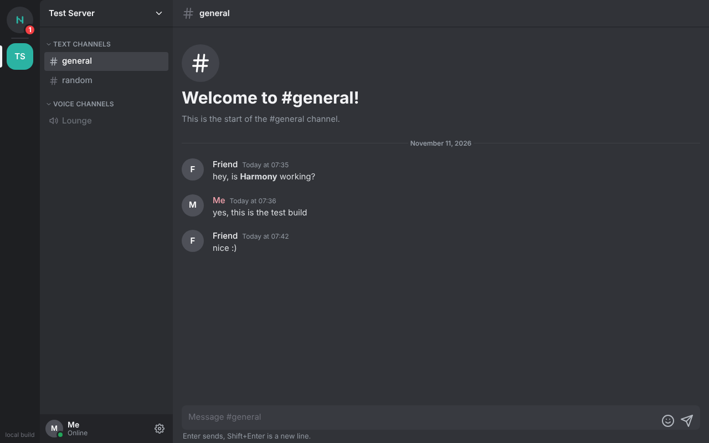

# Harmony

A fast, native Discord client for Windows, written in Rust. The window is a Tauri app drawn by
the system WebView, laid out like Discord, with its own name and look.

Phase 1 is text chat: your servers, channels and DMs, reading and sending messages, plus signed
auto-updates. Reactions, replies, edits, uploads and the rest arrive in later phases, each with
its own safety limits. Voice comes last.



## Read this first

- **Third-party clients are against Discord's Terms of Service.** Accounts can be banned for
  using one. Use a **test account** you can afford to lose, not your main one.
- Harmony signs in with your **account token**. Anyone with that token has full control of your
  account. Never paste it anywhere else, never commit it, never share a screenshot of it.
- The account-safety rules are in [SAFETY.md](SAFETY.md). Changes to them need the project
  owner's explicit approval.

## Install

Download `Harmony-Setup.exe` from the newest `harmony-v…` release and run it. It installs for
your Windows user only (no admin) into `%LOCALAPPDATA%\Programs\Harmony`, and adds the Microsoft
WebView2 runtime if your PC doesn't have it.

Harmony checks its GitHub Releases at start and every 30 minutes (Settings > Updates). An update
installs only if its signature matches the key built into Harmony; anything else is deleted
unrun. The repo is private, so the updater needs a GitHub token: set `HARMONY_GITHUB_TOKEN`, or
sign in to GitHub with Git for Windows (Harmony asks `git credential fill`).

## Signing in

Sign in to Discord in a browser with your test account, open DevTools, and copy the
`Authorization` header from any request to `discord.com/api`. Paste it into Harmony's sign-in
screen. It goes straight to the Windows Credential Manager and nowhere else; the window never
keeps it. Sign out (Settings > Account) deletes it. Changing the account's password invalidates
it.

## Build from source

Needs Rust from https://rustup.rs.

```powershell
powershell -ExecutionPolicy Bypass -File build-exe.ps1
```

That runs the tests and writes `build\Harmony.exe`. A hand build is a "local build" and never
updates itself. `cargo run` starts a debug build. Logs go to stderr; set `HARMONY_LOG=debug` for
more. The token and message text are never logged.

## Releases and the update key (one-time setup)

Every push to `main` builds, signs and publishes a release (`.github/workflows/release.yml`).
Before the first one, make the signing key once:

1. `cargo run --release --bin harmony-keygen`
2. Commit the `update-key.pub` it wrote.
3. Add the private key it printed as the repo's Actions secret **HARMONY_SIGNING_KEY**
   (Settings > Secrets and variables > Actions). Keep no other copy you don't need: anyone with
   it can sign updates.

Until both exist, the workflow refuses to publish anything.

## Layout

| Path | What it does |
| --- | --- |
| `ui/` | The window: HTML, CSS and ES modules (layout adapted from the hbv launcher UI) |
| `ui/js/features.js` | Which actions the UI offers; everything not in Phase 1 is off |
| `src/main.rs` | Window, commands the UI can call, single instance |
| `src/core.rs` | Answers the UI's requests from the gateway and REST, through the safety limits |
| `src/store.rs` | Servers, channels, DMs and history Harmony knows about |
| `src/describe.rs` | Turns Discord messages into what the UI draws |
| `src/gateway.rs` | Websocket: sign-in, heartbeat, resume, reconnect, events |
| `src/rest.rs` | HTTP API: rate limits, retries, circuit breaker |
| `src/safety.rs` | Every account-safety limit, in one place |
| `src/token.rs` | Token type that can't be printed; keychain load, save, delete |
| `src/updates.rs`, `src/signing.rs` | Update check, download, signature check, install |
| `src/bin/` | `harmony-keygen` and `harmony-sign`, the release-signing tools |
| `installer.iss`, `build-exe.ps1` | The Windows installer and build |

## Tests

```sh
cargo test
```
